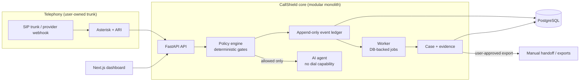

# CallShield Network

Self-hostable, open-source tooling for defending against persistent unwanted telephone solicitation, requesting removal from calling lists, and building a defensible evidence trail.

> **Status: pre-alpha. Synthetic/local prototype only.**
> This software is **not cleared** for real telephony, call recording, live AI speech processing, real outbound calling, or filing with any agency. Those capabilities stay disabled until the legal and technical gates in [`docs/legal/release-gates.md`](docs/legal/release-gates.md) pass. Nothing here is legal advice. See [`DISCLAIMER.md`](DISCLAIMER.md).

## What it does

| Pillar | Purpose |
|---|---|
| **Defend** | Screen inbound calls on lines you control. Deterministic rules decide first; an LLM never decides routing alone. Trusted callers get through, unknown callers are screened, failures fall back to ordinary routing. |
| **Resolve** | Case management for opt-out requests: manual attempt logging, timeline and next steps. Acknowledgment is tracked separately from actual suppression. The automated outbound opt-out call was removed; see the callback flow below. |
| **Enforce** | Append-only, provenance-labeled evidence timeline, versioned exports with hashes, and user-reviewed complaint drafts. Official manual handoff when no documented submission channel exists. |

A fourth module, Community (privacy-preserving campaign signals), is post-MVP and not started (database tables only).

## Status

| Area | State |
|---|---|
| Backend (`apps/api`) | FastAPI modular monolith: auth/tenancy, Defend (lines, routing, screening), Resolve (cases, manual attempts), Enforce (ledger, evidence, case building, exports, filing drafts with manual handoff), callback flow. Unit and integration tests run on SQLite. |
| Dashboard (`apps/dashboard`) | Next.js app over the API: cases, evidence timeline, callback panel, filing. |
| Traceability | [`docs/developer/traceability.md`](docs/developer/traceability.md) has per-requirement status with module and test paths. |

### Callback flow (off by default)

The outbound opt-out call from PRD v3 is **removed**. In its place, the user can authorize a single automated callback to a number that recently called them, to identify who is behind the call for a complaint. It is disabled unless `CALLSHIELD_CALLBACK_CALLBACK_ENABLED=true` and runs only behind seven server-side gates (inbound record, STIR/SHAKEN attestation A, time window, single-use user authorization, blocklist, caps, calling hours), checked at queue time and again before dialing. Counsel release gates G1-G5 must clear before real numbers are called. Spec: [`docs/prd/CHANGE_callback_flow.md`](docs/prd/CHANGE_callback_flow.md). Decision: [ADR 0006](docs/developer/adr/0006-callback-flow-replaces-outbound-opt-out.md).

### Honest limits

- Telephony is mock only. No real SIP trunk, provider adapter dialing, or live call has been exercised.
- Postgres row-level security and the ledger append-only trigger are verified only by the `api-postgres` CI job (`scripts/verify_postgres_rls.py`). That job is new and has not yet run; the local test suite uses SQLite.
- Docker Compose files and the Asterisk harness have not been independently verified.
- No agency submission beyond manual handoff. Legal text is draft and not reviewed by counsel.

## What it will never do (non-goals)

- No automatic rapid redial, and no redial loops of any kind.
- No retaliatory, coordinated, or multi-user calling. No public lists of numbers to call.
- No caller ID spoofing, throttling bypass, or evasion of provider/telecom rules.
- No AI that threatens, impersonates regulators, or promises legal damages.
- No bulk or automatic complaint submission.
- No unconsented recording or live interception.
- No claim that a company is responsible for calls based only on displayed caller ID.
- No voice biometrics, and no callback to numbers without an A-attested inbound record.

The "11 calls to get removed" story that motivated the project is user friction evidence, not a dialing quota. See [PRD section 1](docs/prd/PRD_v3.md).

## Architecture

Modular monolith for R0/R1 (see [ADR 0001](docs/developer/adr/0001-modular-monolith.md)).



More: [`docs/developer/architecture.md`](docs/developer/architecture.md).

## Repository layout

```
apps/api/            FastAPI backend (Python 3.12)
apps/dashboard/      Next.js dashboard
apps/worker/         background worker (planned)
packages/            domain packages (planned; see PRD section 13)
integrations/        asterisk R0 harness, voice-provider and local-AI adapter notes
infra/docker/        Dockerfiles and Compose
infra/monitoring/    Prometheus config and alert rules
scripts/             policy_guard.py, verify_postgres_rls.py
tests/               unit, integration, telephony, legal-policy, red-team
docs/                prd, legal drafts, developer, deployment, privacy
```

## Quickstart (synthetic mode only)

```bash
python -m venv apps/api/.venv && source apps/api/.venv/bin/activate   # Windows: .venv/Scripts/activate
pip install -e "apps/api[dev]"
cd apps/api
callshield init          # wizard: every risky feature defaults to NO; secrets are generated
callshield db upgrade
callshield doctor        # PASS/WARN/FAIL with fix hints
callshield run api       # http://127.0.0.1:8000
```

Then send a synthetic call and open the dashboard: [`docs/quickstart.md`](docs/quickstart.md) (about 10 minutes). Docker Compose: [`docs/deployment/self-hosting.md`](docs/deployment/self-hosting.md). Use fictional numbers only (555-01xx).

Connecting a real SIP trunk (any provider; profiles are unverified templates): [`docs/deployment/connect-your-sip-trunk.md`](docs/deployment/connect-your-sip-trunk.md). Every setting: [`docs/deployment/configuration-reference.md`](docs/deployment/configuration-reference.md). Before real calls: [`docs/deployment/going-live-checklist.md`](docs/deployment/going-live-checklist.md).

## Documentation

- Start here: [`docs/quickstart.md`](docs/quickstart.md), [`connect your SIP trunk`](docs/deployment/connect-your-sip-trunk.md), [`going live`](docs/deployment/going-live-checklist.md)
- Spec: [`docs/prd/PRD_v3.md`](docs/prd/PRD_v3.md) (sections 19-22 control on conflict)
- Legal drafts (not legal advice): [`docs/legal/`](docs/legal/)
- Decisions: [`docs/developer/decision-log.md`](docs/developer/decision-log.md)
- Policies: [`SECURITY.md`](SECURITY.md), [`PRIVACY.md`](PRIVACY.md), [`ACCEPTABLE_USE.md`](ACCEPTABLE_USE.md), [`DISCLAIMER.md`](DISCLAIMER.md)

## Contributing

Read [`CONTRIBUTING.md`](CONTRIBUTING.md). PRs that add dial capability, give an LLM tool access, or loosen a safety gate need security-owner review.

## License

AGPL-3.0-only (provisional, pending counsel review; decision D-004). See [`LICENSE`](LICENSE).
