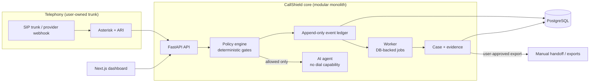

# CallShield Network

Self-hostable, open-source tooling for defending against persistent unwanted telephone solicitation, requesting removal from calling lists, and building a defensible evidence trail.

> **Status: pre-alpha. Synthetic/local prototype only.**
> This software is **not cleared** for real telephony, call recording, live AI speech processing, real outbound calling, or filing with any agency. Those capabilities stay disabled until the legal and technical gates in [`docs/legal/release-gates.md`](docs/legal/release-gates.md) pass. Nothing here is legal advice. See [`DISCLAIMER.md`](DISCLAIMER.md).

## What it does

| Pillar | Purpose |
|---|---|
| **Defend** | Screen inbound calls on lines you control. Deterministic rules decide first; an LLM never decides routing alone. Trusted callers get through, unknown callers are screened, failures fall back to ordinary routing. |
| **Resolve** | Case management for opt-out requests. You start a bounded, purpose-specific contact to a *verified* business endpoint. Acknowledgment is tracked separately from actual suppression. |
| **Enforce** | Append-only, provenance-labeled evidence timeline, versioned exports with hashes, and user-reviewed complaint drafts. Official manual handoff when no documented submission channel exists. |

A fourth module, Community (privacy-preserving campaign signals), is post-MVP and off by default.

## What it will never do (non-goals)

- No automatic rapid redial, and no redial loops of any kind.
- No retaliatory, coordinated, or multi-user calling. No public lists of numbers to call.
- No caller ID spoofing, throttling bypass, or evasion of provider/telecom rules.
- No AI that threatens, impersonates regulators, or promises legal damages.
- No bulk or automatic complaint submission.
- No unconsented recording or live interception.
- No claim that a company is responsible for calls based only on displayed caller ID.

The "11 calls to get removed" story that motivated the project is user friction evidence, not a dialing quota. See [PRD section 1](docs/prd/PRD_v3.md).

## Architecture

Modular monolith for R0/R1 (see [ADR 0001](docs/developer/adr/0001-modular-monolith.md)).



More: [`docs/developer/architecture.md`](docs/developer/architecture.md).

## Repository layout

```
apps/api/            FastAPI backend (Python 3.12)
apps/dashboard/      Next.js dashboard (planned)
apps/worker/         background worker (planned)
packages/            domain packages (planned; see PRD section 13)
integrations/        asterisk R0 harness, voice-provider and local-AI adapter notes
infra/docker/        Dockerfiles and Compose
infra/monitoring/    Prometheus config and alert rules
scripts/             policy_guard.py and repo tooling
tests/               unit, integration, telephony, legal-policy, red-team
docs/                prd, legal drafts, developer, deployment, privacy
```

## Quickstart (synthetic mode only)

```bash
cp env.example .env              # every risky capability is false by default
docker compose -f infra/docker/docker-compose.yml up --build
# or, without Docker:
cd apps/api && pip install -e ".[dev]" && pytest
```

Details and limits: [`docs/deployment/self-hosting.md`](docs/deployment/self-hosting.md). Use fictional numbers only (555-01xx).

## Documentation

- Spec: [`docs/prd/PRD_v3.md`](docs/prd/PRD_v3.md) (sections 19-22 control on conflict)
- Legal drafts (not legal advice): [`docs/legal/`](docs/legal/)
- Decisions: [`docs/developer/decision-log.md`](docs/developer/decision-log.md)
- Policies: [`SECURITY.md`](SECURITY.md), [`PRIVACY.md`](PRIVACY.md), [`ACCEPTABLE_USE.md`](ACCEPTABLE_USE.md), [`DISCLAIMER.md`](DISCLAIMER.md)

## Contributing

Read [`CONTRIBUTING.md`](CONTRIBUTING.md). PRs that add dial capability, give an LLM tool access, or loosen a safety gate need security-owner review.

## License

AGPL-3.0-only (provisional, pending counsel review; decision D-004). See [`LICENSE`](LICENSE).
