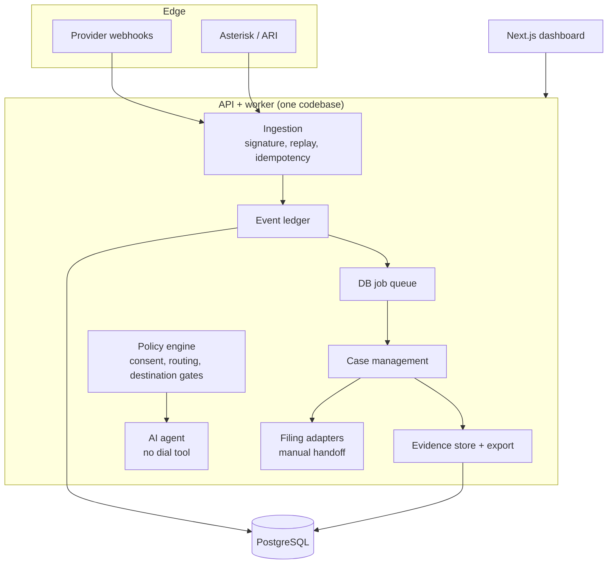
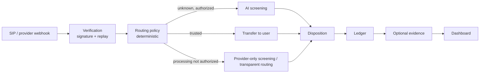
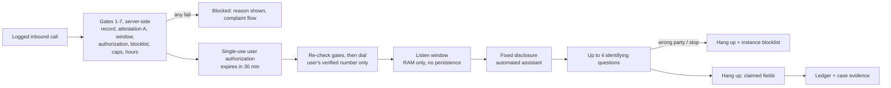
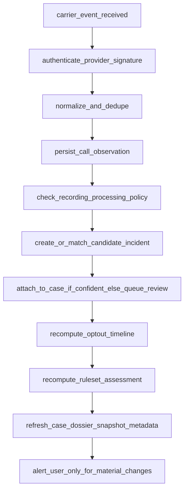

# Architecture

Source: PRD 7, 8, 19. Pre-alpha; module names are targets and may differ from code as it lands. Modular monolith per [ADR 0001](adr/0001-modular-monolith.md).

## Components

## Inbound flow (PRD 7.2)

## Outbound callback flow (CHANGE_callback_flow; replaces PRD 7.2 outbound resolution)

> Supersedes the PRD 7.2 outbound opt-out call, which was removed (ADR 0006). The callback is off by default (`CALLSHIELD_CALLBACK_CALLBACK_ENABLED=false`) and counsel-gated (G1-G5).

The AI has no dial tool (ADR 0003). Caps are enforced in the dialer service. The old `start-contact` and `contact-authorizations` endpoints return `410 OUTBOUND_OPT_OUT_REMOVED`.

## Automatic case-building worker (PRD 19.12)

Jobs are idempotent; original provider webhook references are retained; derived assessments store model and rule versions; no LLM decides on further calls or complaints.

## State machines

- Resolve (5.2.1; the automated contact states are superseded by the callback flow, manual attempts still use them): `CREATED -> DESTINATION_REVIEW -> VERIFIED_DESTINATION -> USER_APPROVED_CONTACT -> IN_PROGRESS -> REQUEST_DELIVERED -> {ACKNOWLEDGED, UNCONFIRMED, REFUSED, INTERRUPTED} -> {MONITORING, NEXT_STEP_REVIEW, CLOSED}`. `ACKNOWLEDGED` never equals suppression.
- Case (19.3): `OPENED -> INTAKE -> EVIDENCE_COLLECTING -> REVIEW_REQUIRED -> ELIGIBLE_TO_DRAFT -> DRAFT_READY -> USER_APPROVED -> SUBMISSION_IN_PROGRESS -> SUBMITTED / SUBMISSION_FAILED -> AGENCY_ACKNOWLEDGED -> MONITORING -> SUPPLEMENT_PENDING -> CLOSED`, with guards per 19.3.

## Failure modes (PRD 7.3)

SIP registration failure -> notify, safe fallback. AI latency -> transfer/neutral fallback/terminate per config. Stream lost -> never infer successful opt-out. Duplicate webhook -> idempotent. Unknown recording legality -> disable live AI media. Missing verified destination -> block AI outbound. Credential compromise -> revoke, rotate, alert. Provider forbids automated calls -> disable outbound AI. Community backend offline -> local features unaffected.

## Cross-cutting rules

- Every telephony/legal/financial command carries `actor_id`, `scope`, `authorization_basis`, `idempotency_key`.
- All network functions default disabled.
- Tenant isolation on every relation (Postgres RLS via `app.tenant_id`; checked by the `api-postgres` CI job, not yet run).
- Prompt policies and rulesets are separately versioned.
