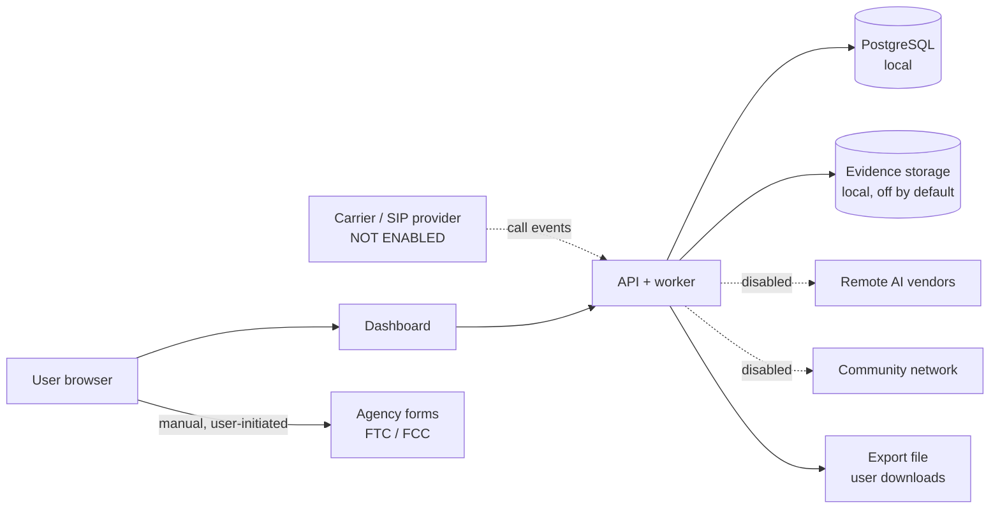

# Data Flows

Current state of a default self-hosted install. Update with every change that moves data. Source: PRD Appendix D, 7, 11.

Dotted = disabled by default.

| Flow | Data | Default | Controls |
|---|---|---|---|
| Carrier -> API | Call signaling metadata, observed caller ID | Disabled (synthetic only) | Signature validation, replay defense, idempotency |
| API -> Postgres | Ledger, cases, audit, settings | On, local | Tenant isolation, redacted logs |
| API -> evidence storage | Audio/transcripts | Off | Consent gate per jurisdiction (D-002); retention |
| API -> remote AI | Audio/text | Off (`CALLSHIELD_REMOTE_AI_ENABLED=false`) | Local-only AI option; processor disclosure |
| API -> maintainers | Anything | **None.** No telemetry. | n/a |
| API -> community | Minimized indicators | Off, not implemented | Separate opt-in |
| User -> agency | Complaint contents | Manual handoff by the user | Exact-payload approval and attestation |
| Export | Case bundle | User-initiated | Manifest, hashes, redaction, scope selection |

## Data classes and provenance

Each stored fact is labeled `OBSERVED`, `CLAIMED`, `MODEL_INFERRED`, `USER_ATTESTED`, or `EXTERNALLY_VERIFIED`. Observed caller ID is never treated as a verified identity.

## Change checklist

When adding a flow: update this file, `PRIVACY.md`, the processor list, retention, and get privacy-owner review.
